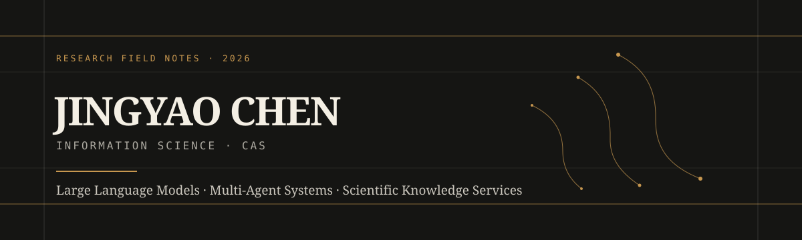

  

  <a href="https://jyaochen.cn">Website</a>
  &nbsp;·&nbsp;
  <a href="https://github.com/JYao-Chen?tab=repositories">Repositories</a>

## 一张索引卡

我是陈靖耀，中国科学院文献情报中心情报学博士研究生。关注大语言模型、多智能体，以及人工智能如何参与科学知识服务。

| 研究线索 | 正在关心 |
| :-- | :-- |
| **语言模型** | 模型能力与专业知识环境如何更可靠地连接 |
| **多智能体** | 复杂研究任务中的分工、协同与可控编排 |
| **知识服务** | 让检索、证据与推理更贴近真实研究过程 |

## 研究之外

历史、文学与传统文化是另一条长线。常从诗词、典故和思想史中辨认时代的纹理，也喜欢在博物馆、美术馆、古迹与城市的行走中，把文献、器物、建筑和日常重新连起来。

> 知识不只需要被储存，也值得被重新看见、理解与使用。

## 此处的代码

置顶仓库会陆续收录研究中的工具、实验与可复用的资料。欢迎浏览、交流，或从 [个人网站](https://jyaochen.cn) 的文章与影像开始。

  Jingyao Chen · Research notes, tools, and field observations.

