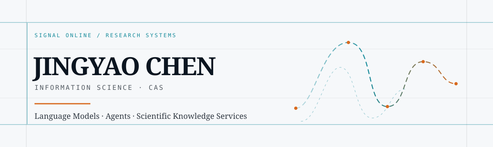

<picture>
  <source media="(prefers-color-scheme: dark)" srcset="./assets/profile-banner.svg" />
  <source media="(prefers-color-scheme: light)" srcset="./assets/profile-banner-light.svg" />
  
</picture>

  <a href="https://jyaochen.cn">Website</a>
  &nbsp;·&nbsp;
  <a href="https://jyaochen.cn/posts">Writing</a>
  &nbsp;·&nbsp;
  <a href="https://jyaochen.cn/photo">Visual archive</a>
  &nbsp;·&nbsp;
  <a href="https://jyaochen.cn/reading">Reading</a>

<h3 align="center">Jingyao Chen · PhD Student in Information Science</h3>

  Large Language Models · Multi-Agent Systems · AI for Scientific Knowledge Services

 

> I am interested in a quieter question than making models answer faster: how can they collaborate, retrieve, and reason more reliably inside complex knowledge environments?

## Research signals

<table>
  <tr>
    <td width="33%" valign="top">
      01 / MODEL  
      <strong>Language models</strong> 
      Connecting model capabilities with specialist knowledge environments.
    </td>
    <td width="33%" valign="top">
      02 / AGENT  
      <strong>Multi-agent systems</strong> 
      Coordination, division of work, and controllable orchestration for complex research tasks.
    </td>
    <td width="33%" valign="top">
      03 / SERVICE  
      <strong>Knowledge services</strong> 
      Bringing retrieval, evidence, and reasoning closer to real research practice.
    </td>
  </tr>
</table>

## Beyond the lab

History, literature, and traditional culture form another long thread. I read poetry, allusions, and intellectual history for the worlds they disclose; I also learn through museums, architecture, historical sites, and city walks—where documents, artifacts, and everyday life meet.

<table>
  <tr>
    <td width="50%" valign="top">
      <strong>On the shelf</strong> 
      Classical literature · history · cultural texts
    </td>
    <td width="50%" valign="top">
      <strong>In the field</strong> 
      Museums · galleries · historical sites · urban space
    </td>
  </tr>
</table>

 

<strong>中文版本 / Switch to Chinese</strong>

 

<h3>陈靖耀 · 情报学博士研究生</h3>

我关注大语言模型、多智能体，以及人工智能如何参与科学知识服务。

> 比起让模型更快地产出答案，我更关心它们如何在复杂的知识环境中，提供更可靠的协作、检索与判断。

<table>
  <tr>
    <td width="33%" valign="top">
      01 / MODEL  
      <strong>大语言模型</strong> 
      让模型能力与专业知识环境建立可靠连接。
    </td>
    <td width="33%" valign="top">
      02 / AGENT  
      <strong>多智能体</strong> 
      探索复杂研究任务中的分工、协同与可控编排。
    </td>
    <td width="33%" valign="top">
      03 / SERVICE  
      <strong>科学知识服务</strong> 
      让检索、证据与推理更贴近真实研究过程。
    </td>
  </tr>
</table>

历史、文学与传统文化是另一条长线。常从诗词、典故和思想史中辨认时代的纹理；也喜欢在博物馆、美术馆、古迹与城市的行走中，把文献、器物、建筑和日常重新连起来。

  <a href="https://jyaochen.cn">个人网站</a>
  &nbsp;·&nbsp;
  <a href="https://jyaochen.cn/posts">文章</a>
  &nbsp;·&nbsp;
  <a href="https://jyaochen.cn/photo">影像</a>
  &nbsp;·&nbsp;
  <a href="https://jyaochen.cn/reading">阅读</a>

 

  Research notes · tools · texts · field observations

